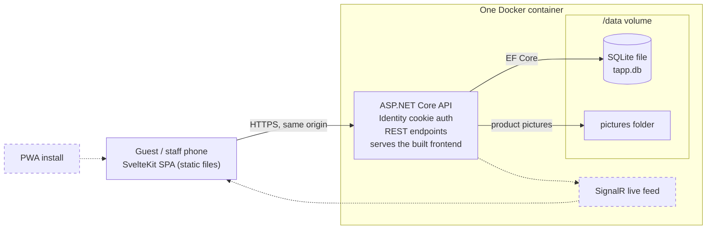
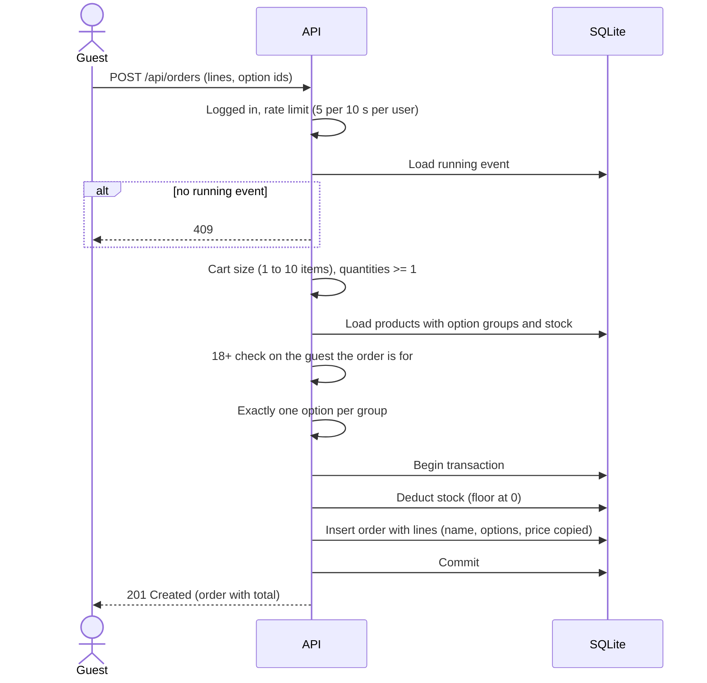
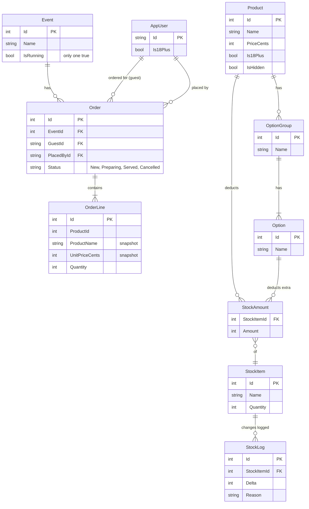

# Architecture

Three small diagrams of the minimal stack. See the [README](../README.md) for the reasoning behind the choices.

## 1. Components

Everything runs in one Docker container. The API serves the built SvelteKit files from the same origin, so there is no CORS and the Identity cookie just works. Dashed boxes are planned, not built yet.

## 2. Order flow

`POST /api/orders` for a guest (or staff ordering on a guest's behalf). Every check happens on the server. Stock never blocks an order: quantities just stop at 0.

Failed checks return 400 (validation), 403 (guest mismatch or 18+) or 429 (rate limit). Staff must pass a `guestId`; a guest may only order for themselves.

## 3. Data model

Key fields only. `AppUser` is the ASP.NET Core Identity user with an extra `Is18Plus` flag. `StockAmount` is an owned type stored per product or option (how much of a stock item one unit uses). `OrderLine` copies the product name, options and price at order time, so later menu edits never change history.

