# Tapp: analyse- en ontwerpdocument

Avans Deeltijd Informatica, opdracht validering eerste leerjaar.
Versie 1.0, november 2026.

## Inhoud

1. [Inleiding](#1-inleiding)
2. [Analyse van eisen en wensen](#2-analyse-van-eisen-en-wensen)
3. [Kwaliteitscriteria en validatie](#3-kwaliteitscriteria-en-validatie)
4. [Functioneel ontwerp](#4-functioneel-ontwerp)
5. [Interactieontwerp](#5-interactieontwerp)
6. [Databaseontwerp](#6-databaseontwerp)
7. [Technisch ontwerp (UML)](#7-technisch-ontwerp-uml)
8. [Aanbevelingen](#8-aanbevelingen)

---

## 1. Inleiding

### 1.1 Aanleiding

Op een thuisfeest of een kleine horecavond loopt de gastheer de hele avond rond om te vragen wat mensen willen drinken. Bestellingen worden vergeten, niemand weet wat er nog op voorraad is en achteraf is niet te zien wie wat heeft gehad. Tapp lost dat op: gasten bestellen zelf vanaf hun telefoon, medewerkers zien de bestellingen binnenkomen en de voorraad loopt automatisch mee.

### 1.2 Doel van het systeem

Tapp is een webapplicatie waarmee:

- gasten het menu bekijken en zelf bestellingen plaatsen;
- medewerkers bestellingen zien en de status bijwerken (nieuw, in bereiding, geserveerd, geannuleerd);
- de beheerder producten, voorraad, events en gebruikers onderhoudt (CRUD);
- alle gebruikers eerst moeten inloggen, zodat iedere bestelling aan een persoon hangt.

### 1.3 Afbakening

- Schaal: thuisgebruik, maximaal circa 50 gasten per event (meestal rond de 25).
- Geen betalingen. Wel wordt de prijs per bestelregel vastgelegd, zodat betalen later kan worden toegevoegd zonder de historie te herschrijven.
- Eén locatie. Meerdere locaties zijn een mogelijke uitbreiding.
- Taal van de interface: Nederlands.

### 1.4 Leeswijzer

Hoofdstuk 2 en 3 beschrijven *wat* het systeem moet doen en hoe we controleren dat het goed is. Hoofdstuk 4 en 5 beschrijven hoe de gebruiker ermee werkt. Hoofdstuk 6 en 7 beschrijven hoe het technisch in elkaar zit: eerst de database in drie stappen (conceptueel, relationeel, DDL), daarna de UML-diagrammen. Hoofdstuk 8 sluit af met aanbevelingen.

Alle diagrammen staan als PlantUML-bron in [`docs/diagrams`](diagrams), met een geëxporteerde PNG ernaast. Na een wijziging worden de PNG's opnieuw gemaakt met `plantuml -tpng docs/diagrams/*.puml`. De wireframes staan als SVG in [`docs/wireframes`](wireframes).

---

## 2. Analyse van eisen en wensen

### 2.1 Belanghebbenden en rollen

| Rol | Wie | Belang |
|---|---|---|
| Beheerder (admin) | De gastheer of eigenaar | Overzicht over voorraad en bestellingen, regie over wie wat mag bestellen |
| Medewerker (employee) | Helpers achter de bar of in de keuken | Snel zien wat er gemaakt moet worden, status bijwerken, namens gasten bestellen |
| Gast (guest) | Bezoekers van het feest | Zonder wachten bestellen vanaf de eigen telefoon, zien wanneer de bestelling klaar is |

De beheerder is tegelijk opdrachtgever. De eisen zijn verzameld door het huidige verloop van een feest uit te schrijven (wie vraagt wat, waar gaat het mis) en dat met de opdrachtgever te bespreken. De volledige featurelijst staat in [FEATURES.md](FEATURES.md). Hieronder staat de versie die voor deze opdracht is geprioriteerd.

### 2.2 Functionele eisen

Prioriteit volgens MoSCoW: **M**ust, **S**hould, **C**ould, **W**on't (nu niet).

| ID | Eis | Rol | Prio | Status |
|---|---|---|---|---|
| FE-01 | Gebruikers loggen in met gebruikersnaam en wachtwoord en kunnen uitloggen | Alle | M | Gebouwd (API) |
| FE-02 | Er is geen openbare registratie: de beheerder maakt accounts aan, kiest de rol en geeft aan of iemand 18+ is | Admin | M | Gebouwd (API) |
| FE-03 | De beheerder kan gebruikers bekijken, wijzigen (rol, 18+) en verwijderen | Admin | M | Gebouwd (API) |
| FE-04 | De beheerder beheert producten: naam, omschrijving, categorie, prijs, foto, 18+, verborgen | Admin | M | Gebouwd (API) |
| FE-05 | Een product kan optiegroepen hebben (bijvoorbeeld "Type: Zero of Normaal"); de gast kiest precies één optie per groep | Admin, gast | M | Gebouwd (API) |
| FE-06 | De beheerder beheert voorraaditems (naam, eenheid) en past de hoeveelheid aan met een reden; iedere aanpassing wordt gelogd | Admin | M | Gebouwd (API) |
| FE-07 | Een product of optie verbruikt één of meer voorraaditems met een vaste hoeveelheid; bij een bestelling wordt dat automatisch afgeboekt | Systeem | M | Gebouwd (API) |
| FE-08 | De beheerder start en stopt een event; bij het starten kiest de beheerder "voorraad meenemen" of "leeg beginnen" | Admin | M | Gebouwd (API) |
| FE-09 | Een gast plaatst een bestelling voor zichzelf binnen het lopende event | Gast | M | Gebouwd (API) |
| FE-10 | Een medewerker plaatst een bestelling namens een gast | Medewerker | M | Gebouwd (API) |
| FE-11 | Producten met 18+ kunnen alleen besteld worden voor gasten met 18+, ook als een medewerker de bestelling plaatst | Systeem | M | Gebouwd (API) |
| FE-12 | Een gast ziet de eigen bestellingen met status; medewerkers zien alle bestellingen van het lopende event | Alle | M | Gebouwd (API) |
| FE-13 | Medewerkers wijzigen de status van een bestelling | Medewerker | M | Gebouwd (API) |
| FE-14 | De interface voor al het bovenstaande, bruikbaar op telefoon en laptop | Alle | M | In ontwikkeling |
| FE-15 | Bestellingen en statuswijzigingen verschijnen live, zonder te verversen | Alle | S | Gepland |
| FE-16 | Indicatie van lage voorraad | Admin | S | Gepland |
| FE-17 | Een gast zonder 18+ kan 18+ aanvragen; de beheerder keurt goed of af | Gast, admin | S | Gepland |
| FE-18 | Statistieken per event: top-producten, totaal per gast, voorraadverbruik | Admin | S | Gepland |
| FE-19 | Aparte wachtrijen voor bar en keuken | Medewerker | C | Gepland |
| FE-20 | Inloggen met QR-code of magic link | Gast | C | Later |
| FE-21 | Betalen of een openstaande rekening per gast | Gast, admin | W | Later |

### 2.3 Niet-functionele eisen

| ID | Eis | Toelichting |
|---|---|---|
| NFE-01 | Alle bedrijfsregels (18+, voorraad, rechten) worden op de server afgedwongen | De interface is nooit te vertrouwen |
| NFE-02 | Wachtwoorden worden gehasht opgeslagen; na herhaald mislukt inloggen volgt een tijdelijke blokkade | Via ASP.NET Core Identity |
| NFE-03 | Maximaal 5 bestellingen per 10 seconden per gebruiker en maximaal 10 stuks per bestelling | Spam voorkomen, "20 bier in één seconde" |
| NFE-04 | De site werkt op schermen vanaf 320 px breed tot desktop (responsive) | Gasten gebruiken hun telefoon |
| NFE-05 | HTML valideert zonder fouten bij validator.w3.org, CSS bij jigsaw.w3.org | Eis uit de opdracht |
| NFE-06 | Opmaak staat los van de HTML in eigen CSS-bestanden | Eis uit de opdracht |
| NFE-07 | Een API-verzoek reageert binnen 300 ms bij 50 gelijktijdige gebruikers op een gewone laptop | Ruim voldoende voor een feest |
| NFE-08 | Het hele systeem draait als één Docker-container met de data op een volume | Eenvoudig te installeren en te back-uppen |
| NFE-09 | Prijzen en voorraad zijn gehele getallen (centen, stuks, ml) | Geen afrondingsfouten |
| NFE-10 | Tekstcontrast voldoet aan WCAG 2.1 AA (minimaal 4,5:1) | Leesbaar in een donkere ruimte |

---

## 3. Kwaliteitscriteria en validatie

### 3.1 Kwaliteitscriteria

De criteria zijn ingedeeld volgens de kwaliteitskenmerken van ISO 25010. Per criterium staat hoe we het meten.

| Kenmerk | Criterium | Hoe gevalideerd |
|---|---|---|
| Functionele geschiktheid | Alle Must-eisen (FE-01 t/m FE-14) werken zoals beschreven | Acceptatietests (3.3) en geautomatiseerde API-tests |
| Functionele correctheid | Voorraad na een bestelling = voorraad ervoor − (hoeveelheid × aantal), nooit onder 0 | xUnit-test `Order_deducts_option_stock_and_snapshots_the_price` en `Stock_stops_at_zero...` |
| Beveiliging | Een gast kan geen beheerfuncties aanroepen; zonder login is alles behalve inloggen afgeschermd (401/403) | xUnit-tests per endpoint met gast-, medewerker- en admin-account |
| Beveiliging | 18+-producten zijn niet te bestellen voor een gast zonder 18+ | xUnit-test `Eighteen_plus_is_checked_on_the_guest...` |
| Betrouwbaarheid | Gegevens blijven consistent: geen bestelling zonder event, geen bestelregel zonder bestelling | Foreign key constraints in de database (hoofdstuk 6) |
| Bruikbaarheid | Een gast plaatst een eerste bestelling binnen 30 seconden na inloggen, zonder uitleg | Gebruikerstest met 3 personen die de app nog niet kennen |
| Bruikbaarheid | Alle knoppen zijn minimaal 44 × 44 px op mobiel | Controle in de browser-devtools |
| Toegankelijkheid | Contrast ≥ 4,5:1, alle formuliervelden hebben een label, één `h1` per pagina | Kleurwaarden in 5.4, Lighthouse-toegankelijkheidsscore ≥ 90 |
| Onderhoudbaarheid | Code volgt de lagen uit het klassendiagram (7.1); geen databasecode in de views | Code review per pull request |
| Overdraagbaarheid | `docker run` op een schone machine levert een werkende app | Handmatige test vóór oplevering |
| Prestatie | NFE-07 | Belastingtest met 50 virtuele gebruikers |

### 3.2 Definition of Done

Een onderdeel (user story of feature) is af als:

1. de code via een pull request op `main` is gemerged, na review;
2. de geautomatiseerde tests (`dotnet test`) slagen en er tests zijn voor nieuwe bedrijfsregels;
3. de server elke invoer valideert en bij fouten een duidelijke statuscode geeft (400, 401, 403, 404, 409);
4. de pagina's van het onderdeel zonder fouten door de W3C HTML- en CSS-validator komen;
5. de pagina's werken op 360 px (mobiel) en 1280 px (desktop) breed;
6. dit ontwerpdocument nog klopt met wat er gebouwd is, of is bijgewerkt.

### 3.3 Acceptatie- en testcriteria

| Test | Eis | Gegeven | Wanneer | Dan |
|---|---|---|---|---|
| T-01 | FE-01 | Gebruiker `anna` met wachtwoord `secret1` | Anna logt in met een fout wachtwoord | Melding "onjuiste gegevens", geen toegang (401) |
| T-02 | FE-02 | Ingelogd als gast | De gast probeert een gebruiker aan te maken | Geweigerd (403) |
| T-03 | FE-05 | Cola heeft optiegroep Type met Zero en Normaal | Gast bestelt Cola zonder optie | Geweigerd (400): "kies precies één optie per groep" |
| T-04 | FE-07 | Voorraad cola zero = 10 | Gast bestelt 2× Cola Zero | Voorraad cola zero = 8, cola normaal ongewijzigd |
| T-05 | FE-08 | Er loopt al een event | Admin start een tweede event | Geweigerd (409) |
| T-06 | FE-09 | Er loopt geen event | Gast bestelt | Geweigerd (409): "geen lopend event" |
| T-07 | FE-11 | Gast zonder 18+, product Bier is 18+ | Medewerker bestelt Bier namens deze gast | Geweigerd (403), voorraad ongewijzigd |
| T-08 | FE-12 | Anna en Bert hebben elk een bestelling | Bert opent "Mijn bestellingen" | Bert ziet alleen de eigen bestelling |
| T-09 | FE-13 | Bestelling #12 is "Nieuw" | Gast probeert de status te wijzigen | Geweigerd (403); een medewerker kan het wel |
| T-10 | FE-06 | Voorraaditem wordt gebruikt door een product | Admin verwijdert het voorraaditem | Geweigerd (409); na verwijderen van het product lukt het wel |
| T-11 | NFE-03 | Gast plaatst 7 bestellingen binnen 10 seconden | | De eerste 5 slagen, de andere 2 krijgen 429 |
| T-12 | NFE-05 | Een willekeurige pagina in de browser | Gerenderde HTML en de CSS gaan door de W3C-validators | 0 fouten |

T-01 t/m T-11 zijn geautomatiseerd als xUnit-integratietests in `api/Tapp.Api.Tests`. Die tests starten de echte API met een tijdelijke SQLite-database. T-12 is handmatig.

---

## 4. Functioneel ontwerp

### 4.1 Usecasediagram

Links de actoren, in het kader het systeem met de usecases. Een beheerder is ook een medewerker (generalisatie): een beheerder kan alles wat een medewerker kan. *Controle 18+* en *Voorraad afboeken* zijn met «include» aan het bestellen gekoppeld, omdat ze bij iedere bestelling verplicht meelopen.

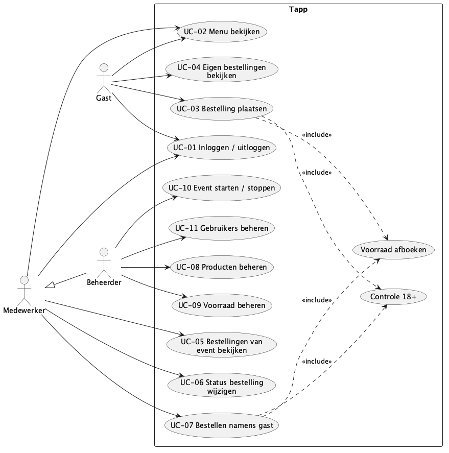

Bron: [`diagrams/use-cases.puml`](diagrams/use-cases.puml)

### 4.2 Usecasebeschrijving UC-03: Bestelling plaatsen

| Onderdeel | Beschrijving |
|---|---|
| **Naam** | UC-03 Bestelling plaatsen |
| **Actor** | Gast (primair). Medewerker via UC-07, met hetzelfde verloop. |
| **Doel** | De gast bestelt één of meer producten die bij de bar of keuken binnenkomen. |
| **Precondities** | De gast is ingelogd (UC-01). Er loopt een event. |
| **Postcondities (succes)** | Er is een bestelling met status *Nieuw* in het lopende event, met per regel de productnaam, gekozen opties en prijs op dat moment. De voorraad van de gebruikte voorraaditems is verlaagd (niet onder 0). |
| **Postcondities (fout)** | Er is niets opgeslagen en de voorraad is ongewijzigd. |
| **Trigger** | De gast tikt op "Bestellen" in de winkelwagenbalk. |

**Hoofdscenario**

1. De gast opent het menu. Het systeem toont de zichtbare producten per categorie met prijs en een 18+-label waar dat geldt.
2. De gast tikt bij een product op "+".
3. Als het product optiegroepen heeft, toont het systeem een venster waarin de gast per groep precies één optie kiest en het aantal instelt.
4. De gast voegt het product toe aan de winkelwagen. Het systeem werkt het aantal items en het totaalbedrag in de winkelwagenbalk bij.
5. De gast herhaalt stap 2 t/m 4 voor andere producten.
6. De gast tikt op "Bestellen".
7. Het systeem controleert:
   a. of er een event loopt;
   b. of de bestelling 1 t/m 10 stuks bevat;
   c. of alle producten bestaan en niet verborgen zijn;
   d. of de gast 18+ is als er 18+-producten in zitten;
   e. of per optiegroep precies één bestaande optie is gekozen.
8. Het systeem boekt per voorraaditem de hoeveelheid af en slaat de bestelling op, samen in één transactie.
9. Het systeem toont een bevestiging met bestelnummer en totaalbedrag, en de bestelling staat bij "Mijn bestellingen" met status *Nieuw*.

**Alternatieve scenario's**

| Bij stap | Situatie | Afhandeling |
|---|---|---|
| 7a | Er loopt geen event | Melding "Er loopt nu geen event, bestellen kan niet". Niets opgeslagen. |
| 7b | Meer dan 10 stuks | Melding "Maximaal 10 stuks per bestelling". De winkelwagen blijft staan. |
| 7c | Een product is net verborgen of verwijderd | Melding "Een product is niet meer beschikbaar". De gast past de winkelwagen aan. |
| 7d | 18+-product voor een gast zonder 18+ | Melding "Deze bestelling bevat 18+-producten". 18+-producten zijn in het menu al gemarkeerd. |
| 7e | Optie ontbreekt of hoort niet bij het product | Melding "Kies één optie per groep bij <product>". |
| 6 | Meer dan 5 bestellingen in 10 seconden | Melding "Even rustig aan, probeer het zo opnieuw" (429). |
| 8 | Voorraad is (bijna) op | Bestelling gaat wel door; de voorraad stopt op 0. Bewuste keuze: de telling op een feest is grof, en een gast mag niet geweigerd worden door een telfout. |

**Uitzondering:** de sessie is verlopen. Het systeem geeft 401 en stuurt de gast naar het inlogscherm. De winkelwagen blijft in de browser bewaard.

### 4.3 Overige usecases (kort)

| UC | Actor | Korte beschrijving |
|---|---|---|
| UC-01 | Alle | Inloggen met gebruikersnaam en wachtwoord; na 5 fouten tijdelijk geblokkeerd. Uitloggen wist de sessie-cookie. |
| UC-02 | Alle | Producten per categorie; verborgen producten alleen voor de beheerder. |
| UC-04 | Gast | Lijst met eigen bestellingen in het lopende event, nieuwste eerst, met status. |
| UC-05 | Medewerker | Alle bestellingen van het lopende event, gegroepeerd per status. |
| UC-06 | Medewerker | Status naar *In bereiding*, *Geserveerd* of *Geannuleerd* zetten. |
| UC-07 | Medewerker | Als UC-03, maar eerst de gast kiezen. De 18+-controle geldt voor de gast, niet voor de medewerker. |
| UC-08 | Beheerder | Product toevoegen, wijzigen, verbergen of verwijderen, inclusief optiegroepen, voorraadverbruik en foto. |
| UC-09 | Beheerder | Voorraaditem toevoegen, wijzigen of verwijderen; hoeveelheid corrigeren met reden; mutatielog bekijken. |
| UC-10 | Beheerder | Event starten (voorraad meenemen of op 0 zetten, dat laatste wordt gelogd) en stoppen. |
| UC-11 | Beheerder | Gebruiker aanmaken, rol en 18+ wijzigen, verwijderen. Een gebruiker met bestellingen kan niet verwijderd worden, en de beheerder kan zichzelf niet wijzigen of verwijderen. |

---

## 5. Interactieontwerp

### 5.1 Welke informatie per scherm

| Scherm | Rol | Informatie | Acties |
|---|---|---|---|
| Inloggen | Iedereen | Gebruikersnaam, wachtwoord, foutmelding | Inloggen |
| Menu | Gast, medewerker | Categorieën, per product foto, naam, prijs, 18+-label; winkelwagenbalk met aantal en totaal | Filteren op categorie, toevoegen, bestellen |
| Opties kiezen | Gast, medewerker | Productnaam, optiegroepen met opties, aantal, regelprijs | Optie kiezen, aantal wijzigen, toevoegen |
| Mijn bestellingen | Gast | Per bestelling nummer, tijd, regels, totaal, status | (alleen lezen) |
| Bestellingen | Medewerker | Bestellingen van het event per status: nummer, gast, tijd, regels, totaal | Status wijzigen, bestellen namens gast |
| Producten | Beheerder | Tabel met naam, categorie, prijs, 18+, verborgen; formulier met alle velden | Toevoegen, wijzigen, verwijderen, foto uploaden |
| Voorraad | Beheerder | Naam, eenheid, hoeveelheid, mutatielog | Toevoegen, wijzigen, verwijderen, corrigeren |
| Events | Beheerder | Lopend event, eerdere events met start- en eindtijd | Starten (meenemen of leeg), stoppen |
| Gebruikers | Beheerder | Gebruikersnaam, rol, 18+ | Toevoegen, wijzigen, verwijderen |

### 5.2 Navigatie

De navigatie hangt af van de rol. Na inloggen komt een gast op het menu, en een medewerker of beheerder op de bestellingen. Op mobiel zit de navigatie achter het menu-icoon (☰), op desktop staat hij als tekstlinks in de bovenbalk.

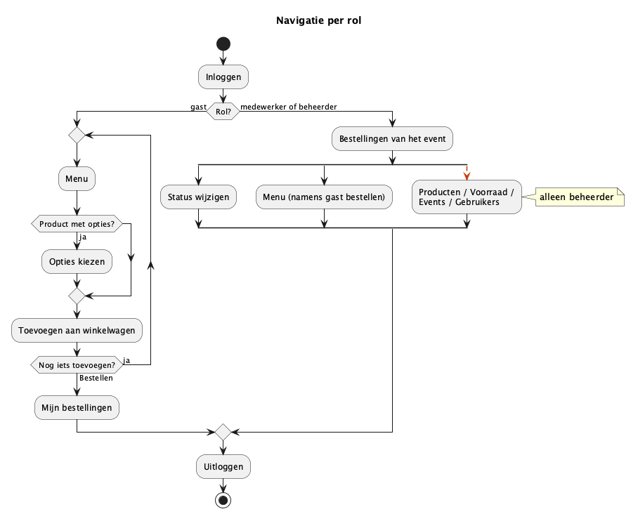

Bron: [`diagrams/navigation.puml`](diagrams/navigation.puml)

### 5.3 Lay-out en responsive design

- **Mobile first.** De basis-CSS is voor een smal scherm; met `min-width`-mediaqueries komt er ruimte bij.
- **Breekpunten:**

  | Breedte | Lay-out |
  |---|---|
  | < 40rem (640 px) | Eén kolom, navigatie achter ☰, winkelwagenbalk vast onderaan, opties als venster vanaf onderen |
  | ≥ 40rem | Meer witruimte (padding 2rem), productkaarten in twee kolommen |
  | ≥ 64rem (1024 px) | Navigatie als tekstlinks in de bovenbalk; bestellingen in drie kolommen per status; beheerschermen met tabel links en formulier rechts |

- De inhoud is maximaal 60rem breed en gecentreerd, zodat regels op een groot scherm niet te lang worden.
- Knoppen en aanraakvlakken zijn minimaal 44 × 44 px.
- De lay-out gebruikt CSS Grid en Flexbox; er zijn geen vaste pixelbreedtes voor kolommen.

### 5.4 Kleurenschema

Warm en rustig, passend bij een café of feest. Eén accentkleur (oranje, "tap") voor alle acties, zodat altijd duidelijk is wat aanklikbaar is. Status gebruikt naast kleur ook tekst, zodat kleurenblinde gebruikers het ook zien.

| Rol | CSS-variabele | Kleur | Gebruik | Contrast |
|---|---|---|---|---|
| Achtergrond | `--color-bg` | `#faf8f5` | Pagina-achtergrond | n.v.t. |
| Vlak | `--color-surface` | `#ffffff` | Kaarten, formulieren, bovenbalk | n.v.t. |
| Tekst | `--color-text` | `#1f2328` | Gewone tekst | 14,9 : 1 op achtergrond |
| Gedempte tekst | `--color-muted` | `#5b6470` | Prijzen, labels, toelichting | 5,7 : 1 |
| Rand | `--color-border` | `#e5e1da` | Randen van kaarten en invoervelden | n.v.t. |
| Primair | `--color-primary` | `#c2410c` | Knoppen, links, actieve navigatie | 5,2 : 1 (wit op oranje) |
| Succes | `--color-success` | `#0f766e` | Status "Geserveerd", bevestigingen | 5,5 : 1 |
| Fout | `--color-danger` | `#b91c1c` | Foutmeldingen, status "Geannuleerd" | 6,5 : 1 |

Alle combinaties halen WCAG 2.1 AA (≥ 4,5 : 1). De variabelen staan in [web/src/app.css](../web/src/app.css), zodat het schema op één plek te wijzigen is.

### 5.5 Lettertypes en -groottes

- **Lettertype:** de systeemletter (`system-ui, -apple-system, 'Segoe UI', Roboto, sans-serif`). Die is op elk apparaat al aanwezig, laadt dus direct en is goed leesbaar op kleine schermen. Er wordt geen webfont gedownload.
- **Groottes** (in `rem`, zodat de lettergrootte van de browser wordt gerespecteerd):

  | Element | Variabele | Grootte | Gewicht |
  |---|---|---|---|
  | Paginatitel `h1` | `--size-h1` | 1,75rem (28 px) | 600 |
  | Sectietitel `h2` | `--size-h2` | 1,375rem (22 px) | 600 |
  | Gewone tekst, knoppen | `--size-body` | 1rem (16 px) | 400, knoppen 600 |
  | Kleine tekst (labels, status) | `--size-small` | 0,875rem (14 px) | 400 of 600 |

- Regelhoogte 1,5. Invoervelden zijn minimaal 16 px, zodat iOS niet inzoomt bij het typen.

### 5.6 Wireframes

De wireframes gebruiken de kleuren en groottes uit 5.4 en 5.5. Mobiel is ontworpen op 360 px breed, desktop op 1280 px.

**Mobiel: inloggen en menu**

| Inloggen | Menu |
|---|---|
| 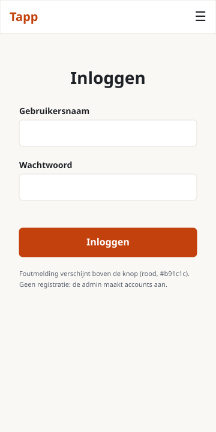 | 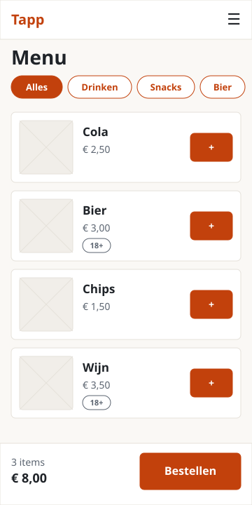 |

Het menu toont categorieën als filterknoppen. Elk product heeft een foto, naam, prijs en eventueel een 18+-label. De winkelwagenbalk staat vast onderaan, zodat "Bestellen" altijd binnen bereik van de duim is.

**Mobiel: opties kiezen en mijn bestellingen**

| Opties kiezen | Mijn bestellingen |
|---|---|
| 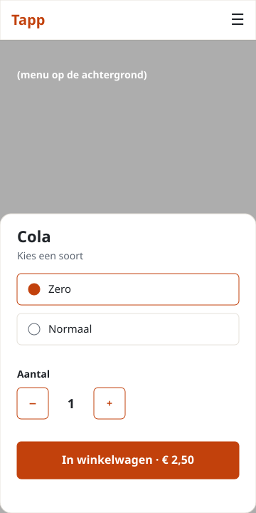 | 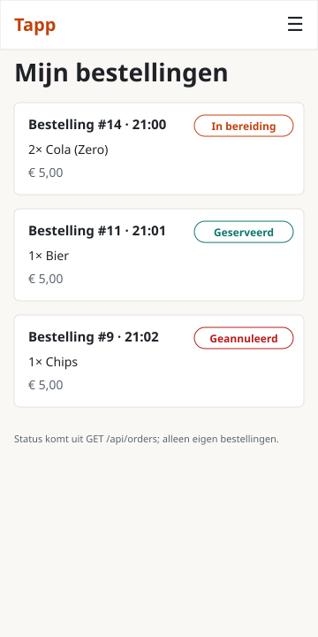 |

Opties verschijnen in een venster vanaf de onderkant, met keuzerondjes (één keuze per groep). Bij de bestellingen staat de status als label met kleur én tekst.

**Desktop: bestellingen (medewerker)**

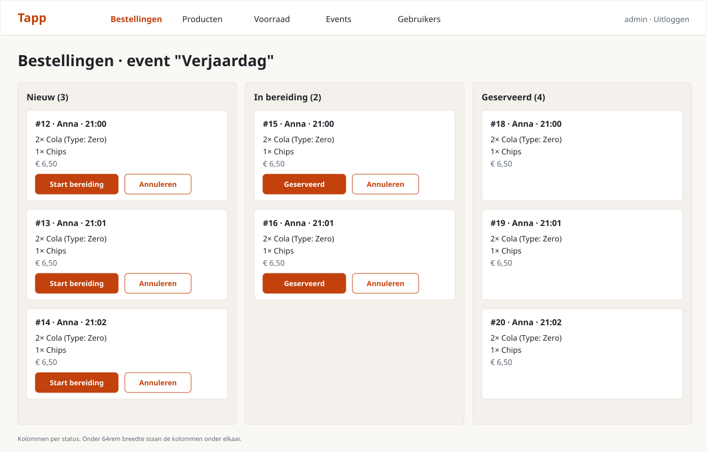

Drie kolommen per status, zoals een kanbanbord. De knoppen op een kaart zetten de bestelling een stap verder. Onder 64rem staan de kolommen onder elkaar.

**Desktop: productbeheer (beheerder)**

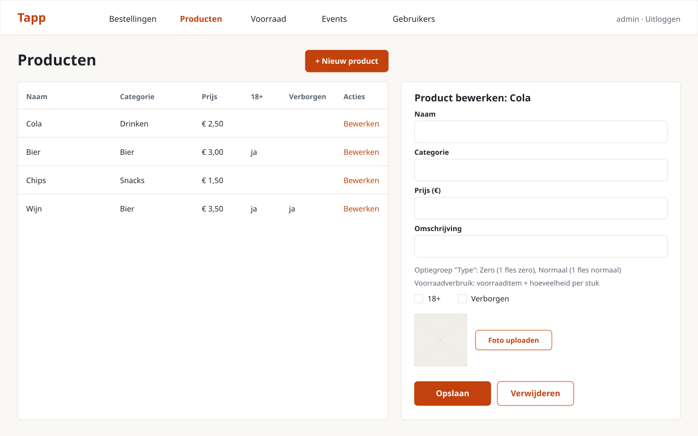

Links de tabel met alle producten, rechts het formulier van het geselecteerde product. Op mobiel opent het formulier als eigen pagina. Voorraad, events en gebruikers hebben dezelfde opbouw (tabel + formulier), zodat de beheerder één patroon hoeft te leren.

---

## 6. Databaseontwerp

Het ontwerp volgt drie stappen: eerst een conceptueel ERD zonder technische details, daarna het relationele schema waarin alle relaties met vreemde sleutels zijn opgelost, en tot slot de DDL met datatypes.

### 6.1 Conceptueel ERD

Alleen entiteiten, relaties en kardinaliteiten. Nog geen vreemde sleutels, datatypes of koppeltabellen.

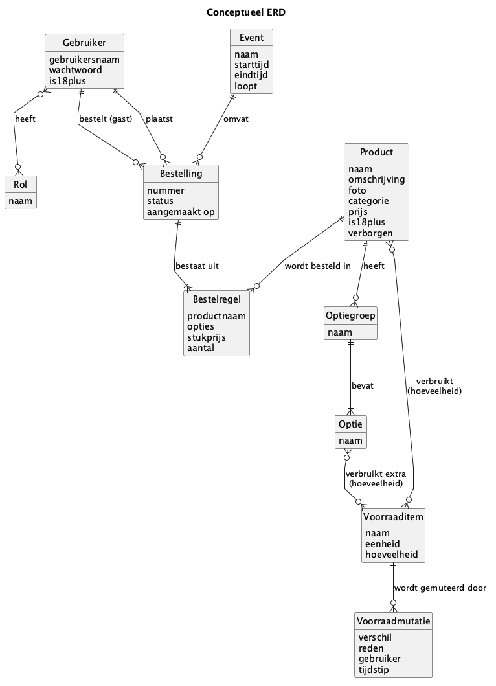

Bron: [`diagrams/erd-conceptual.puml`](diagrams/erd-conceptual.puml)

**Attributen per entiteit**

| Entiteit | Attributen (sleutel onderstreept) |
|---|---|
| Gebruiker | <u>gebruikersnaam</u>, wachtwoord, is18plus |
| Rol | <u>naam</u> (admin, medewerker, gast) |
| Event | <u>naam + starttijd</u>, eindtijd, loopt |
| Bestelling | <u>nummer</u>, status, aangemaakt op |
| Bestelregel | productnaam, opties, stukprijs, aantal |
| Product | <u>naam</u>, omschrijving, foto, categorie, prijs, is18plus, verborgen |
| Optiegroep | naam |
| Optie | naam |
| Voorraaditem | <u>naam</u>, eenheid, hoeveelheid |
| Voorraadmutatie | verschil, reden, gebruiker, tijdstip |

De relaties *verbruikt* en *verbruikt extra* hebben zelf een attribuut: **hoeveelheid** (hoeveel van het voorraaditem één stuk verbruikt).

### 6.2 Relationeel schema

Alle relaties zijn nu opgelost met vreemde sleutels. De drie veel-op-veel-relaties worden koppeltabellen. Notatie: **PK** onderstreept, *FK* cursief met de tabel waarnaar hij verwijst.

- **AspNetUsers** (<u>Id</u>, UserName, PasswordHash, Is18Plus, …)
- **AspNetRoles** (<u>Id</u>, Name)
- **AspNetUserRoles** (<u>*UserId* → AspNetUsers, *RoleId* → AspNetRoles</u>)
- **Events** (<u>Id</u>, Name, StartedAt, EndedAt, IsRunning)
- **Orders** (<u>Id</u>, *EventId* → Events, *GuestId* → AspNetUsers, *PlacedById* → AspNetUsers, Status, CreatedAt)
- **OrderLine** (<u>Id</u>, *OrderId* → Orders, ProductId, ProductName, Options, UnitPriceCents, Quantity)
- **Products** (<u>Id</u>, Name, Description, PicturePath, Category, PriceCents, Is18Plus, IsHidden)
- **OptionGroup** (<u>Id</u>, *ProductId* → Products, Name)
- **Option** (<u>Id</u>, *OptionGroupId* → OptionGroup, Name)
- **StockItems** (<u>Id</u>, Name, Unit, Quantity)
- **Products_Stock** (<u>Id</u>, *OwnerId* → Products, *StockItemId* → StockItems, Amount)
- **Option_Stock** (<u>Id</u>, *OwnerId* → Option, *StockItemId* → StockItems, Amount)
- **StockLogs** (<u>Id</u>, *StockItemId* → StockItems, Delta, Reason, User, At)

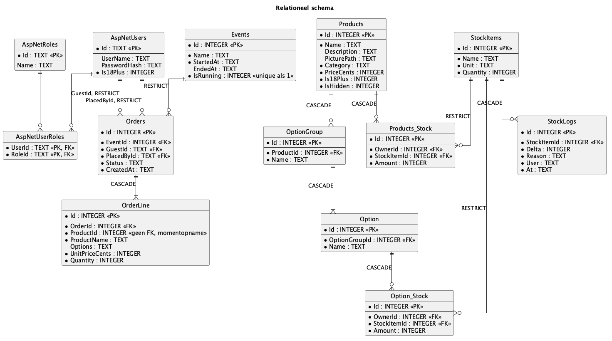

Bron: [`diagrams/relational-schema.puml`](diagrams/relational-schema.puml)

**Bewuste ontwerpkeuzes**

- `OrderLine.ProductId` heeft **geen** vreemde sleutel. Een bestelregel is een momentopname: naam, opties en prijs worden gekopieerd. Zo kan een product later worden gewijzigd of verwijderd zonder dat oude bestellingen veranderen of de verwijdering blokkeren. In het conceptuele ERD staat de relatie *wordt besteld in* wel, omdat die inhoudelijk bestaat.
- `Orders` → `AspNetUsers` en `Orders` → `Events` gebruiken `ON DELETE RESTRICT`: een gast of event met bestellingen kan niet verwijderd worden, zodat de historie compleet blijft.
- `Products_Stock` en `Option_Stock` → `StockItems` gebruiken `RESTRICT`: een voorraaditem dat nog in gebruik is, kan niet weg. Van de kant van het product is het `CASCADE`: verwijder je een product, dan verdwijnen de koppelingen mee.
- Bij `Events` zorgt een gefilterde unieke index (`WHERE IsRunning = 1`) ervoor dat er maximaal één event tegelijk loopt, ook als twee beheerders tegelijk op "Start" drukken.

### 6.3 Veel-op-veel-relaties

Het ontwerp bevat drie veel-op-veel-relaties:

| Relatie | Koppeltabel | Extra attribuut | Betekenis |
|---|---|---|---|
| Product ↔ Voorraaditem | `Products_Stock` | `Amount` | Een product verbruikt meerdere voorraaditems (een cocktail: rum, cola, limoen) en een voorraaditem wordt door meerdere producten gebruikt (cola in "Cola" en in "Rum-cola") |
| Optie ↔ Voorraaditem | `Option_Stock` | `Amount` | Een optie verbruikt extra voorraad bovenop het product (keuze "Zero" verbruikt een fles cola zero) |
| Gebruiker ↔ Rol | `AspNetUserRoles` | geen | Standaard uit ASP.NET Core Identity; Tapp geeft iedere gebruiker één rol, maar het model laat meer toe |

`Products_Stock` is de belangrijkste: daarmee rekent het systeem bij iedere bestelling uit hoeveel voorraad er af moet.

### 6.4 DDL (SQL CREATE TABLE)

De database is SQLite. De statements zijn gegenereerd uit het Entity Framework-model (`dotnet ef dbcontext script`), zodat ze precies overeenkomen met de code.

Opmerkingen bij de datatypes:

- SQLite kent `INTEGER`, `TEXT`, `REAL` en `BLOB`. Een `bool` wordt `INTEGER` (0/1) en een datum `TEXT` in ISO 8601-formaat.
- SQLite controleert geen lengte bij `TEXT`. De ontworpen maximale lengtes staan in de tabel hieronder; ze moeten nog in de applicatie worden afgedwongen (aanbeveling A-06).
- Bedragen staan in centen (`INTEGER`), zodat er nooit afrondingsfouten zijn.

```sql
-- Gebruikers en rollen (ASP.NET Core Identity, alleen de gebruikte tabellen)
CREATE TABLE "AspNetRoles" (
    "Id"               TEXT NOT NULL CONSTRAINT "PK_AspNetRoles" PRIMARY KEY,
    "Name"             TEXT NULL,
    "NormalizedName"   TEXT NULL,
    "ConcurrencyStamp" TEXT NULL
);

CREATE TABLE "AspNetUsers" (
    "Id"                   TEXT    NOT NULL CONSTRAINT "PK_AspNetUsers" PRIMARY KEY,
    "Is18Plus"             INTEGER NOT NULL,
    "UserName"             TEXT    NULL,
    "NormalizedUserName"   TEXT    NULL,
    "Email"                TEXT    NULL,
    "NormalizedEmail"      TEXT    NULL,
    "EmailConfirmed"       INTEGER NOT NULL,
    "PasswordHash"         TEXT    NULL,
    "SecurityStamp"        TEXT    NULL,
    "ConcurrencyStamp"     TEXT    NULL,
    "PhoneNumber"          TEXT    NULL,
    "PhoneNumberConfirmed" INTEGER NOT NULL,
    "TwoFactorEnabled"     INTEGER NOT NULL,
    "LockoutEnd"           TEXT    NULL,
    "LockoutEnabled"       INTEGER NOT NULL,
    "AccessFailedCount"    INTEGER NOT NULL
);

CREATE TABLE "AspNetUserRoles" (
    "UserId" TEXT NOT NULL,
    "RoleId" TEXT NOT NULL,
    CONSTRAINT "PK_AspNetUserRoles" PRIMARY KEY ("UserId", "RoleId"),
    CONSTRAINT "FK_AspNetUserRoles_AspNetRoles_RoleId" FOREIGN KEY ("RoleId") REFERENCES "AspNetRoles" ("Id") ON DELETE CASCADE,
    CONSTRAINT "FK_AspNetUserRoles_AspNetUsers_UserId" FOREIGN KEY ("UserId") REFERENCES "AspNetUsers" ("Id") ON DELETE CASCADE
);

-- Events en bestellingen
CREATE TABLE "Events" (
    "Id"        INTEGER NOT NULL CONSTRAINT "PK_Events" PRIMARY KEY AUTOINCREMENT,
    "Name"      TEXT    NOT NULL,
    "StartedAt" TEXT    NOT NULL,
    "EndedAt"   TEXT    NULL,
    "IsRunning" INTEGER NOT NULL
);

CREATE TABLE "Orders" (
    "Id"         INTEGER NOT NULL CONSTRAINT "PK_Orders" PRIMARY KEY AUTOINCREMENT,
    "EventId"    INTEGER NOT NULL,
    "GuestId"    TEXT    NOT NULL,
    "PlacedById" TEXT    NOT NULL,
    "Status"     TEXT    NOT NULL,
    "CreatedAt"  TEXT    NOT NULL,
    CONSTRAINT "FK_Orders_AspNetUsers_GuestId"    FOREIGN KEY ("GuestId")    REFERENCES "AspNetUsers" ("Id") ON DELETE RESTRICT,
    CONSTRAINT "FK_Orders_AspNetUsers_PlacedById" FOREIGN KEY ("PlacedById") REFERENCES "AspNetUsers" ("Id") ON DELETE RESTRICT,
    CONSTRAINT "FK_Orders_Events_EventId"         FOREIGN KEY ("EventId")    REFERENCES "Events" ("Id")      ON DELETE RESTRICT
);

CREATE TABLE "OrderLine" (
    "Id"             INTEGER NOT NULL CONSTRAINT "PK_OrderLine" PRIMARY KEY AUTOINCREMENT,
    "ProductId"      INTEGER NOT NULL,
    "ProductName"    TEXT    NOT NULL,
    "Options"        TEXT    NULL,
    "UnitPriceCents" INTEGER NOT NULL,
    "Quantity"       INTEGER NOT NULL,
    "OrderId"        INTEGER NOT NULL,
    CONSTRAINT "FK_OrderLine_Orders_OrderId" FOREIGN KEY ("OrderId") REFERENCES "Orders" ("Id") ON DELETE CASCADE
);

-- Catalogus
CREATE TABLE "Products" (
    "Id"          INTEGER NOT NULL CONSTRAINT "PK_Products" PRIMARY KEY AUTOINCREMENT,
    "Name"        TEXT    NOT NULL,
    "Description" TEXT    NULL,
    "PicturePath" TEXT    NULL,
    "Category"    TEXT    NOT NULL,
    "PriceCents"  INTEGER NOT NULL,
    "Is18Plus"    INTEGER NOT NULL,
    "IsHidden"    INTEGER NOT NULL
);

CREATE TABLE "OptionGroup" (
    "Id"        INTEGER NOT NULL CONSTRAINT "PK_OptionGroup" PRIMARY KEY AUTOINCREMENT,
    "Name"      TEXT    NOT NULL,
    "ProductId" INTEGER NOT NULL,
    CONSTRAINT "FK_OptionGroup_Products_ProductId" FOREIGN KEY ("ProductId") REFERENCES "Products" ("Id") ON DELETE CASCADE
);

CREATE TABLE "Option" (
    "Id"            INTEGER NOT NULL CONSTRAINT "PK_Option" PRIMARY KEY AUTOINCREMENT,
    "Name"          TEXT    NOT NULL,
    "OptionGroupId" INTEGER NOT NULL,
    CONSTRAINT "FK_Option_OptionGroup_OptionGroupId" FOREIGN KEY ("OptionGroupId") REFERENCES "OptionGroup" ("Id") ON DELETE CASCADE
);

-- Voorraad
CREATE TABLE "StockItems" (
    "Id"       INTEGER NOT NULL CONSTRAINT "PK_StockItems" PRIMARY KEY AUTOINCREMENT,
    "Name"     TEXT    NOT NULL,
    "Unit"     TEXT    NOT NULL,
    "Quantity" INTEGER NOT NULL
);

-- Koppeltabel veel-op-veel: Product <-> StockItem
CREATE TABLE "Products_Stock" (
    "Id"          INTEGER NOT NULL CONSTRAINT "PK_Products_Stock" PRIMARY KEY AUTOINCREMENT,
    "StockItemId" INTEGER NOT NULL,
    "Amount"      INTEGER NOT NULL,
    "OwnerId"     INTEGER NOT NULL,
    CONSTRAINT "FK_Products_Stock_Products_OwnerId"       FOREIGN KEY ("OwnerId")     REFERENCES "Products" ("Id")   ON DELETE CASCADE,
    CONSTRAINT "FK_Products_Stock_StockItems_StockItemId" FOREIGN KEY ("StockItemId") REFERENCES "StockItems" ("Id") ON DELETE RESTRICT
);

-- Koppeltabel veel-op-veel: Option <-> StockItem
CREATE TABLE "Option_Stock" (
    "Id"          INTEGER NOT NULL CONSTRAINT "PK_Option_Stock" PRIMARY KEY AUTOINCREMENT,
    "StockItemId" INTEGER NOT NULL,
    "Amount"      INTEGER NOT NULL,
    "OwnerId"     INTEGER NOT NULL,
    CONSTRAINT "FK_Option_Stock_Option_OwnerId"         FOREIGN KEY ("OwnerId")     REFERENCES "Option" ("Id")     ON DELETE CASCADE,
    CONSTRAINT "FK_Option_Stock_StockItems_StockItemId" FOREIGN KEY ("StockItemId") REFERENCES "StockItems" ("Id") ON DELETE RESTRICT
);

CREATE TABLE "StockLogs" (
    "Id"          INTEGER NOT NULL CONSTRAINT "PK_StockLogs" PRIMARY KEY AUTOINCREMENT,
    "StockItemId" INTEGER NOT NULL,
    "Delta"       INTEGER NOT NULL,
    "Reason"      TEXT    NOT NULL,
    "User"        TEXT    NOT NULL,
    "At"          TEXT    NOT NULL,
    CONSTRAINT "FK_StockLogs_StockItems_StockItemId" FOREIGN KEY ("StockItemId") REFERENCES "StockItems" ("Id") ON DELETE CASCADE
);

-- Maximaal één lopend event
CREATE UNIQUE INDEX "IX_Events_IsRunning" ON "Events" ("IsRunning") WHERE IsRunning = 1;
```

Identity maakt ook nog `AspNetUserClaims`, `AspNetUserLogins`, `AspNetUserTokens` en `AspNetRoleClaims` aan. Tapp gebruikt die niet; ze staan in de migraties in `api/Tapp.Api/Migrations`.

**Logische datatypes en lengtes**

| Kolom | Logisch type | Lengte / bereik |
|---|---|---|
| `UserName` | tekst | 3 t/m 50 tekens |
| `Products.Name`, `StockItems.Name`, `OptionGroup.Name`, `Option.Name` | tekst | 1 t/m 100 tekens |
| `Products.Category`, `StockItems.Unit` | tekst | 1 t/m 50 tekens |
| `Products.Description` | tekst | max. 500 tekens |
| `PriceCents`, `UnitPriceCents` | geheel getal | 0 t/m 100 000 (€ 1000) |
| `Quantity` (voorraad), `Amount` | geheel getal | ≥ 0 resp. ≥ 1 |
| `OrderLine.Quantity` | geheel getal | 1 t/m 10 |
| `Orders.Status` | tekst (enum) | `New`, `Preparing`, `Served`, `Cancelled` |
| Datum/tijd | ISO 8601, UTC | `2026-11-27T21:05:00Z` |

---

## 7. Technisch ontwerp (UML)

### 7.1 Gelaagd klassendiagram

Tapp gebruikt een variant van **MVC** die past bij een API met een losse frontend:

| Laag | MVC-rol | In de code |
|---|---|---|
| Presentatie | View | SvelteKit-pagina's in `web/src/routes` (draaien in de browser) |
| Controller | Controller | De `*Endpoints`-klassen in `api/Tapp.Api/<Onderdeel>/`. Iedere klasse koppelt URL's aan handlers, controleert rechten en invoer, en roept het model aan. |
| Model | Model | De entiteiten in `api/Tapp.Api/Data/` (domein), plus de DTO-records die de controller naar de view stuurt |
| Data | (onderdeel van Model) | `AppDbContext` (Entity Framework Core) en `UserManager` / `SignInManager` (ASP.NET Core Identity) |

Elke laag praat alleen met de laag eronder. De view kent alleen de JSON van de DTO's, niet de entiteiten.

In het diagram staan de handlers als methoden van de controllerklasse, met een naam die de actie beschrijft. In de code zijn de meeste handlers korte lambda's die in `MapX()` worden geregistreerd. Alleen `PlaceAsync` is een benoemde methode, omdat die het meeste werk doet. Het diagram toont de belangrijkste attributen en methoden; Identity-klassen staan er vereenvoudigd in.

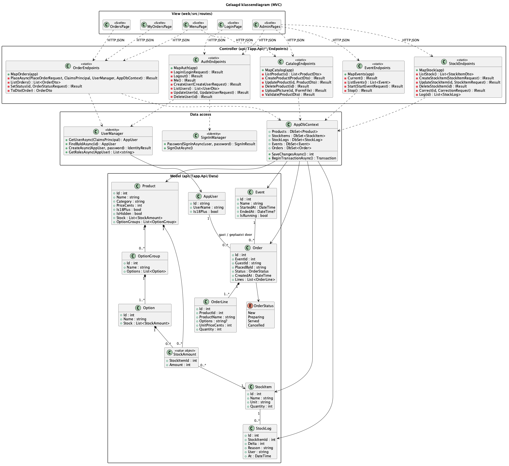

Bron: [`diagrams/class-diagram.puml`](diagrams/class-diagram.puml)

**Toelichting bij de keuzes**

- *Compositie* (◆) bij `Product → OptionGroup → Option` en `Order → OrderLine`: de delen bestaan niet zonder het geheel. Verwijder je een product, dan verdwijnen de optiegroepen en opties ook. Dat staat ook zo in de database (`ON DELETE CASCADE`).
- `StockAmount` is een *value object*: het zegt "dit product verbruikt 1 fles cola zero". Het heeft geen eigen identiteit in het domein, en via deze klasse ontstaat de veel-op-veel-relatie tussen product en voorraaditem (zie 6.3).
- `OrderLine` kopieert naam, opties en prijs. Daardoor verandert een oude bestelling niet als het menu later wijzigt.

### 7.2 Sequentiediagram: bestelling plaatsen (UC-03)

Alleen klassen en methoden uit het klassendiagram worden gebruikt.

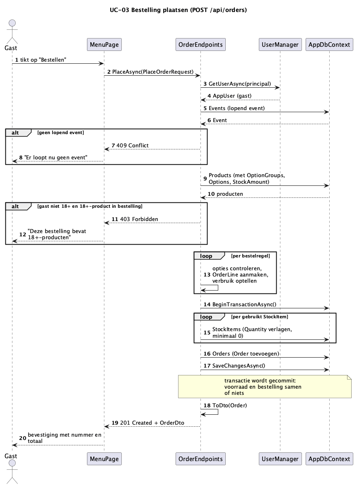

Bron: [`diagrams/sequence-place-order.puml`](diagrams/sequence-place-order.puml)

Een medewerker die namens een gast bestelt (UC-07), volgt hetzelfde pad. Het enige verschil is dat `OrderEndpoints` de gast ophaalt met `UserManager.FindByIdAsync(guestId)` in plaats van de ingelogde gebruiker te nemen. De 18+-controle gebeurt dan op die gast.

### 7.3 Deploymentdiagram

Knopen (`«device»`, `«execution environment»`) zijn de hardware en de omgevingen waarin software draait; de artefacten zijn de bestanden die erop staan.

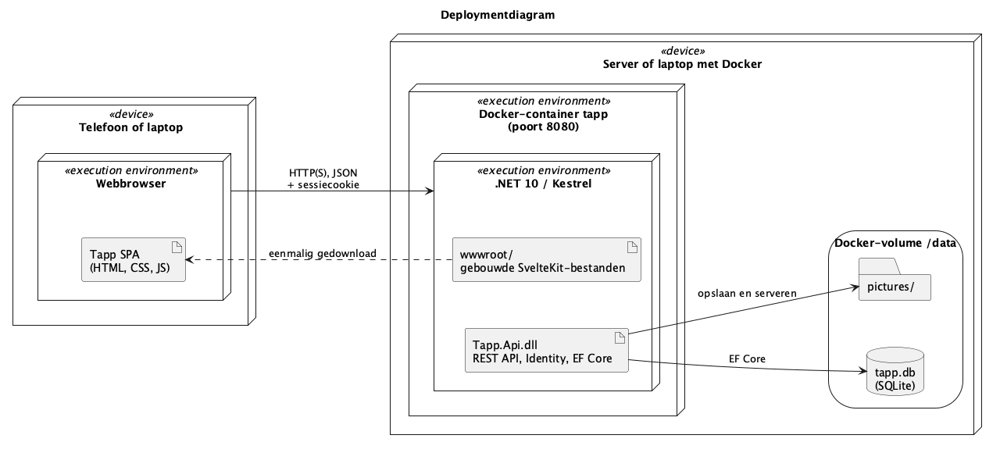

Bron: [`diagrams/deployment.puml`](diagrams/deployment.puml)

- De API serveert ook de frontend. Daardoor staan beide op hetzelfde adres (same origin): geen CORS nodig, en de inlogcookie werkt zonder extra instellingen.
- De database en de foto's staan op een volume. Een nieuwe versie van de container kan worden gestart zonder dataverlies; een back-up is een kopie van `/data`.
- Bij gebruik buiten het eigen netwerk hoort er een reverse proxy met HTTPS (bijvoorbeeld Caddy of Traefik) vóór de container (zie aanbevelingen).

### 7.4 API-overzicht

Dit overzicht koppelt de controllers aan de usecases en rollen.

| Methode en pad | Rol | UC |
|---|---|---|
| `POST /api/auth/login`, `POST /api/auth/logout`, `GET /api/auth/me` | Iedereen / ingelogd | UC-01 |
| `GET /api/users`, `POST /api/users`, `PUT /api/users/{id}`, `DELETE /api/users/{id}` | Beheerder | UC-11 |
| `GET /api/products` | Ingelogd | UC-02 |
| `POST /api/products`, `PUT /api/products/{id}`, `DELETE /api/products/{id}`, `POST /api/products/{id}/picture` | Beheerder | UC-08 |
| `GET /api/stock` | Medewerker | UC-09 |
| `POST /api/stock`, `PUT /api/stock/{id}`, `DELETE /api/stock/{id}`, `POST /api/stock/{id}/corrections`, `GET /api/stock/{id}/log` | Beheerder | UC-09 |
| `GET /api/events/current` | Ingelogd | UC-03 |
| `GET /api/events`, `POST /api/events`, `POST /api/events/current/stop` | Beheerder | UC-10 |
| `POST /api/orders` | Ingelogd | UC-03, UC-07 |
| `GET /api/orders` | Ingelogd (gast: eigen) | UC-04, UC-05 |
| `PATCH /api/orders/{id}/status` | Medewerker | UC-06 |

---

## 8. Aanbevelingen

| # | Aanbeveling | Waarom | Prioriteit |
|---|---|---|---|
| A-01 | Bouw eerst de schermen voor UC-01 t/m UC-06 (gast en medewerker) en pas daarna de beheerschermen | Daarmee is een feest al te draaien; de beheerder kan in het begin de API gebruiken | Hoog |
| A-02 | Valideer iedere pagina met de W3C-validator door de **gerenderde** HTML te plakken (rechtermuisklik, "Inspecteren", `<html>` kopiëren) | SvelteKit bouwt de pagina in de browser op; de validator ziet via een URL alleen het lege skelet | Hoog |
| A-03 | Zet een reverse proxy met HTTPS vóór de container zodra de app buiten het eigen wifi-netwerk bereikbaar is | Wachtwoorden en de sessiecookie gaan nu onversleuteld over HTTP | Hoog (bij hosting) |
| A-04 | Voeg live updates toe met SignalR (FE-15) | Medewerkers hoeven dan niet te verversen; dit zit al in ASP.NET Core | Middel |
| A-05 | Bouw de 18+-aanvraag (FE-17) en een lage-voorraadmelding (FE-16) | Staan als MVP in de featurelijst, maar zijn niet nodig voor de kern | Middel |
| A-06 | Leg de maximale lengtes uit 6.4 vast met `HasMaxLength` in het EF-model en controleer ze in de endpoints | SQLite controleert geen lengte; nu kan een extreem lange naam de lay-out breken | Middel |
| A-07 | Maak een dagelijkse back-up van het volume `/data` | Eén bestand bevat alle gegevens | Middel |
| A-08 | Overweeg Postgres pas bij meerdere locaties of honderden gelijktijdige gebruikers | SQLite is ruim voldoende voor 50 gasten; overstappen is een EF-migratie | Laag |
| A-09 | Voer de gebruikerstest uit 3.1 uit vóór het eerste echte feest | Bruikbaarheid voor gasten die de app nooit gezien hebben is het grootste risico | Hoog |
